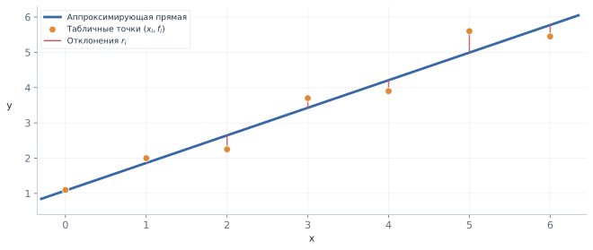
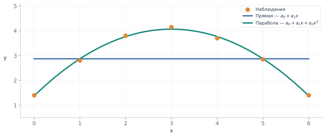

# Метод наименьших квадратов

ЧИСЛЕННЫЕ МЕТОДЫ · ГЛАВА 01

Полный последовательный разбор аппроксимации табличных данных: от прямой и параболы до многочлена произвольной степени и выбора базисных функций. Сохранены исходные обозначения <strong>xᵢ, fᵢ, aⱼ, φ</strong>; рядом с выводами даны дополнительные пояснения.

МНК · Нормальные уравнения · Полиномиальная аппроксимация

## 1. Постановка задачи: приближение таблично заданной функции

В записи лекции от **02.11.2026** сначала рассматривается набор экспериментальных точек. Пусть значения функции известны в узлах $x_0,x_1,\ldots,x_n$:

$$
\begin{array}{c|ccccc}
x & x_0 & x_1 & x_2 & \cdots & x_n\\ \hline
f & f_0 & f_1 & f_2 & \cdots & f_n
\end{array},\qquad f_i=f(x_i).
$$

На координатной плоскости им соответствуют точки $(x_i,f_i)$. Они могут не лежать на одной прямой, хотя общая тенденция данных выглядит линейной. Требуется подобрать простую функцию, которая **приблизительно описывает точки**.

{width=95%}

В тетради сформулирован вопрос: **«Какую прямую выбрать?»** Ответ — такую, для которой совокупное расхождение с экспериментальными значениями будет наименьшим в специально выбранном смысле.

::: {.explain}
**Почему нельзя просто провести прямую через все точки?** Через две точки всегда проходит одна прямая, но три и более экспериментальные точки обычно не коллинеарны. Требование точного прохождения через каждый узел относится к *интерполяции*. Здесь используется *аппроксимация*: не требуется точного совпадения в каждом узле, зато можно уменьшить общий разброс ошибок.
:::

## 2. Метод наименьших квадратов для прямой

### 2.1. Вид искомой функции

Ищем приближающую функцию **первой степени** в том же виде, что и в исходной записи:

$$\boxed{y=a_0+a_1x.}$$

Здесь $a_0$ — свободный член (значение прямой при $x=0$), $a_1$ — коэффициент при $x$ (угловой коэффициент прямой). При подстановке $x_i$ модель выдаёт значение $a_0+a_1x_i$.

Разность между моделью и наблюдаемым значением в $i$-м узле:

$$r_i=a_0+a_1x_i-f_i.$$

На рисунке эти разности изображаются вертикальными отрезками. Слово «расстояния» в лекции здесь следует понимать именно как **отклонения по оси значений функции**, а не как кратчайшие расстояния от точек до прямой.

### 2.2. Функция ошибки

Согласно методу наименьших квадратов составляем сумму квадратов вертикальных отклонений:

$$
\boxed{\varphi(a_0,a_1)=\sum_{i=0}^{n}(a_0+a_1x_i-f_i)^2\longrightarrow\min_{a_0,a_1}.}
$$

Выбираются два коэффициента $a_0$ и $a_1$, при которых $\varphi$ принимает минимальное значение.

::: {.explain}
**Зачем возводить разности в квадрат?** Обычная сумма ошибок может быть близка к нулю даже при больших положительных и отрицательных отклонениях: они взаимно уничтожаются. Квадраты неотрицательны, поэтому большие ошибки увеличивают итоговую сумму. Кроме того, выражение $\varphi$ дифференцируется по неизвестным коэффициентам, что позволяет вывести систему линейных уравнений.
:::

### 2.3. Частные производные: полное преобразование

Чтобы найти минимум дифференцируемой функции $\varphi(a_0,a_1)$, необходимо рассмотреть условия стационарности:

$$
\frac{\partial\varphi}{\partial a_0}=0,\qquad
\frac{\partial\varphi}{\partial a_1}=0.
$$

Вычислим первую производную по $a_0$. Для одного слагаемого применяем правило производной сложной функции:

$$
\frac{\partial}{\partial a_0}(a_0+a_1x_i-f_i)^2
=2(a_0+a_1x_i-f_i)\underbrace{\frac{\partial}{\partial a_0}(a_0+a_1x_i-f_i)}_{=1}.
$$

Поэтому:

$$
\boxed{\frac{\partial\varphi}{\partial a_0}
=2\sum_{i=0}^{n}(a_0+a_1x_i-f_i)=0.}
$$

Аналогично дифференцируем по $a_1$. Внутренняя производная теперь равна $x_i$:

$$
\frac{\partial}{\partial a_1}(a_0+a_1x_i-f_i)^2
=2(a_0+a_1x_i-f_i)x_i.
$$

Следовательно:

$$
\boxed{\frac{\partial\varphi}{\partial a_1}
=2\sum_{i=0}^{n}(a_0+a_1x_i-f_i)x_i=0.}
$$

Полученная в лекции система из двух условий записывается так:

$$
\begin{cases}
2\displaystyle\sum_{i=0}^{n}(a_0+a_1x_i-f_i)=0,\\[6pt]
2\displaystyle\sum_{i=0}^{n}(a_0+a_1x_i-f_i)x_i=0.
\end{cases}
$$

Сократим обе строки на $2$ и раскроем скобки:

$$
\begin{cases}
\displaystyle\sum_{i=0}^{n}a_0+\sum_{i=0}^{n}a_1x_i-\sum_{i=0}^{n}f_i=0,\\[7pt]
\displaystyle\sum_{i=0}^{n}a_0x_i+\sum_{i=0}^{n}a_1x_i^2-\sum_{i=0}^{n}f_ix_i=0.
\end{cases}
$$

Так как $a_0,a_1$ не зависят от индекса $i$, их можно вынести за знак суммы. Кроме того, $\sum_{i=0}^{n}1=n+1$. Поэтому:

$$
\boxed{
\begin{cases}
(n+1)a_0+a_1\displaystyle\sum_{i=0}^{n}x_i=\displaystyle\sum_{i=0}^{n}f_i,\\[9pt]
a_0\displaystyle\sum_{i=0}^{n}x_i+a_1\displaystyle\sum_{i=0}^{n}x_i^2=\displaystyle\sum_{i=0}^{n}f_ix_i.
\end{cases}}
$$

Это **нормальная система уравнений** для коэффициентов прямой. Сначала по таблице вычисляют суммы $\sum x_i$, $\sum x_i^2$, $\sum f_i$, $\sum x_if_i$, после чего решают обычную систему из двух линейных уравнений.

::: {.note}
**Почему стационарная точка здесь является минимумом?** $\varphi$ — сумма квадратов линейных функций от $a_0,a_1$, поэтому она выпукла. Если значения $x_i$ не все одинаковы, матрица нормальной системы невырождена, и решение задаёт единственный глобальный минимум. Если все $x_i$ одинаковы, коэффициенты прямой определить единственным образом нельзя.
:::

### 2.4. Явные формулы коэффициентов

Для удобства обозначим величины, которые уже встречались в системе:

$$
X_1=\sum_{i=0}^{n}x_i,\quad
X_2=\sum_{i=0}^{n}x_i^2,\quad
F_0=\sum_{i=0}^{n}f_i,\quad
F_1=\sum_{i=0}^{n}x_if_i.
$$

Эти заглавные буквы — **только вспомогательные сокращения в объяснении**, исходные коэффициенты $a_0,a_1$ не меняются. Система принимает вид

$$
\begin{cases}
(n+1)a_0+X_1a_1=F_0,\\
X_1a_0+X_2a_1=F_1.
\end{cases}
$$

Из первого уравнения $a_0=(F_0-X_1a_1)/(n+1)$. Подставляя во второе и умножая на $n+1$, получаем

$$X_1F_0-X_1^2a_1+(n+1)X_2a_1=(n+1)F_1.$$

Следовательно,

$$
\boxed{a_1=\frac{(n+1)F_1-X_1F_0}{(n+1)X_2-X_1^2},\qquad
 a_0=\frac{F_0-X_1a_1}{n+1}.}
$$

Знаменатель $D=(n+1)X_2-X_1^2$ положителен, если все $x_i$ не совпадают. В самом деле, $D=(n+1)\sum_{i=0}^{n}(x_i-\overline x)^2$, где $\overline x=\frac{1}{n+1}\sum x_i$.

### 2.5. Полностью разобранный численный пример

::: {.example}
**Дополнительный пример, не из тетради.** Пусть имеются измерения $(x_0,f_0)=(0,1)$, $(x_1,f_1)=(1,2)$, $(x_2,f_2)=(2,2)$. Тогда $n=2$ и

$$\sum_{i=0}^{2}x_i=0+1+2=3,\quad\sum_{i=0}^{2}x_i^2=0+1+4=5,$$

$$\sum_{i=0}^{2}f_i=1+2+2=5,\quad \sum_{i=0}^{2}x_if_i=0\cdot1+1\cdot2+2\cdot2=6.$$

Нормальная система:

$$\begin{cases}3a_0+3a_1=5,\\3a_0+5a_1=6.\end{cases}$$

Вычитая первое уравнение из второго, находим $2a_1=1$, откуда $a_1=\tfrac12$. Тогда $3a_0=5-\tfrac32=\tfrac72$ и $a_0=\tfrac76$.

$$\boxed{y=\frac76+\frac12x.}$$

Остатки равны $\tfrac16,-\tfrac13,\tfrac16$, поэтому сумма квадратов равна

$$\varphi_{\min}=\frac1{36}+\frac1{9}+\frac1{36}=\frac16.$$
:::

## 3. Аппроксимация параболой второй степени

В конспекте далее рассматривается случай, когда прямой для хорошего приближения недостаточно. Вместо неё ищут параболу:

$$\boxed{y=a_0+a_1x+a_2x^2.}$$

График параболы может учитывать кривизну зависимости между $x$ и $f$. Коэффициентов теперь три: $a_0,a_1,a_2$.

{width=95%}

### 3.1. Функция суммы квадратов

$$
\varphi(a_0,a_1,a_2)=\sum_{i=0}^{n}(a_0+a_1x_i+a_2x_i^2-f_i)^2
\longrightarrow\min_{a_0,a_1,a_2}.
$$

Для стационарной точки требуется обнулить **три** частные производные. Выпишем их, не пропуская множители:

$$
\begin{cases}
\displaystyle\frac{\partial\varphi}{\partial a_0}=2\sum_{i=0}^{n}(a_0+a_1x_i+a_2x_i^2-f_i)=0,\\[8pt]
\displaystyle\frac{\partial\varphi}{\partial a_1}=2\sum_{i=0}^{n}(a_0+a_1x_i+a_2x_i^2-f_i)x_i=0,\\[8pt]
\displaystyle\frac{\partial\varphi}{\partial a_2}=2\sum_{i=0}^{n}(a_0+a_1x_i+a_2x_i^2-f_i)x_i^2=0.
\end{cases}
$$

Для третьей производной множитель $x_i^2$ возникает из равенства $\frac{\partial}{\partial a_2}(a_0+a_1x_i+a_2x_i^2-f_i)=x_i^2$.

### 3.2. Подробный вывод нормальной системы

После деления на $2$ и раскрытия каждой суммы имеем:

$$
\begin{cases}
\displaystyle a_0\sum_{i=0}^n1+a_1\sum_{i=0}^nx_i+a_2\sum_{i=0}^nx_i^2-\sum_{i=0}^nf_i=0,\\[9pt]
\displaystyle a_0\sum_{i=0}^nx_i+a_1\sum_{i=0}^nx_i^2+a_2\sum_{i=0}^nx_i^3-\sum_{i=0}^nf_ix_i=0,\\[9pt]
\displaystyle a_0\sum_{i=0}^nx_i^2+a_1\sum_{i=0}^nx_i^3+a_2\sum_{i=0}^nx_i^4-\sum_{i=0}^nf_ix_i^2=0.
\end{cases}
$$

Переносим слагаемые с $f_i$ вправо:

$$
\boxed{\begin{cases}
(n+1)a_0+a_1\displaystyle\sum_{i=0}^nx_i+a_2\displaystyle\sum_{i=0}^nx_i^2=\displaystyle\sum_{i=0}^nf_i,\\[9pt]
a_0\displaystyle\sum_{i=0}^nx_i+a_1\displaystyle\sum_{i=0}^nx_i^2+a_2\displaystyle\sum_{i=0}^nx_i^3=\displaystyle\sum_{i=0}^nf_ix_i,\\[9pt]
a_0\displaystyle\sum_{i=0}^nx_i^2+a_1\displaystyle\sum_{i=0}^nx_i^3+a_2\displaystyle\sum_{i=0}^nx_i^4=\displaystyle\sum_{i=0}^nf_ix_i^2.
\end{cases}}
$$

Сравнивая с системой для прямой, видим, что в верхней строке добавился член с $a_2$, а вся система расширилась до трёх неизвестных.

### 3.3. Сравнение сумм квадратов для прямой и параболы

В лекции введены суммы $S_1$ для прямой и $S_2$ для параболы. Прямая получается из параболы при $a_2=0$, то есть множество допустимых прямых включено в множество допустимых парабол. Поэтому

$$\boxed{S_2\leq S_1.}$$

::: {.correction}
**Уточнение записи из конспекта.** В рукописи рядом с $S_1$ и $S_2$ приведено строгое неравенство $S_1>S_2$. Без дополнительных условий это утверждение слишком сильное: оптимальная парабола иногда совпадает с прямой ($a_2=0$), и тогда $S_1=S_2$. Правильная общая формулировка — $S_2\leq S_1$.
:::

::: {.explain}
**Почему увеличение степени всегда не ухудшает именно сумму квадратов?** Потому что старые коэффициенты остаются допустимыми: можно взять ту же прямую и дополнительно положить $a_2=0$. Оптимум среди большего числа вариантов не может оказаться хуже прежнего. Но это не означает, что модель более высокой степени всегда лучше описывает закономерность вне экспериментальных точек.
:::

## 4. Многочлен произвольной степени

Далее лекция переходит от степени $1$ или $2$ к общей степени $m$ (в записи используется условие $m<n$):

$$\boxed{P_m(x)=\sum_{j=0}^{m}a_jx^j=a_0+a_1x+a_2x^2+\cdots+a_mx^m.}$$

Всего неизвестных коэффициентов **$m+1$**: $a_0,a_1,\ldots,a_m$. Измерений — **$n+1$**, поскольку индекс $i$ идёт от $0$ до $n$.

### 4.1. Минимизируемая функция

$$
\boxed{\varphi(\vec a)=\sum_{i=0}^{n}\left[\sum_{j=0}^{m}a_jx_i^j-f_i\right]^2\longrightarrow\min_{\vec a},\qquad
\vec a=(a_0,a_1,\ldots,a_m).}
$$

Рассмотрим произвольный номер $k$ от $0$ до $m$. При дифференцировании выражения в квадратных скобках по $a_k$ остаётся $x_i^k$:

$$
\frac{\partial}{\partial a_k}\left(\sum_{j=0}^{m}a_jx_i^j-f_i\right)=x_i^k.
$$

Отсюда общее условие:

$$
\boxed{\frac{\partial\varphi}{\partial a_k}
=2\sum_{i=0}^{n}\left[\sum_{j=0}^{m}a_jx_i^j-f_i\right]x_i^k=0,\quad k=0,1,\ldots,m.}
$$

**Подробно переставим суммы:** сначала делим на $2$, затем раскрываем внешнюю сумму и переносим второе слагаемое вправо:

$$
\sum_{i=0}^{n}\left(\sum_{j=0}^{m}a_jx_i^j\right)x_i^k
=\sum_{i=0}^{n}f_ix_i^k.
$$

Перегруппировываем слагаемые по неизвестному коэффициенту $a_j$ (конечные суммы можно менять местами):

$$
\sum_{j=0}^{m}a_j\sum_{i=0}^{n}x_i^jx_i^k
=\sum_{i=0}^{n}f_ix_i^k.
$$

По правилу степеней $x_i^jx_i^k=x_i^{j+k}$, поэтому получаем

$$\boxed{\sum_{j=0}^{m}a_j\left(\sum_{i=0}^{n}x_i^{j+k}\right)
=\sum_{i=0}^{n}f_ix_i^k,\qquad k=0,1,\ldots,m.}$$

Эта формула описывает **систему из $m+1$ линейного уравнения** для $m+1$ коэффициентов. В рукописной записи тот же вывод следует после примеров с прямой и параболой.

::: {.correction}
**Уточнение индекса.** В обобщённой системе номер уравнения должен изменяться от $k=0$ до $k=m$, а не до $n$: коэффициентов модели ровно $m+1$. Верхний предел $n$ используется в суммах **по данным** $i=0,\ldots,n$. Эта разница важна, чтобы не получить лишних уравнений.
:::

### 4.2. Как устроена матрица этой системы

Матричную запись добавляем **как объяснение**, не заменяя ею формулы из лекции. Пусть

$$
A=\begin{pmatrix}
1 & x_0 & x_0^2 & \cdots & x_0^m\\
1 & x_1 & x_1^2 & \cdots & x_1^m\\
\vdots & \vdots & \vdots & & \vdots\\
1 & x_n & x_n^2 & \cdots & x_n^m
\end{pmatrix},\quad
\vec a=\begin{pmatrix}a_0\\a_1\\\vdots\\a_m\end{pmatrix},\quad
\vec f=\begin{pmatrix}f_0\\f_1\\\vdots\\f_n\end{pmatrix}.
$$

Тогда $A\vec a$ — вектор приближённых значений в экспериментальных точках, а

$$\varphi(\vec a)=\|A\vec a-\vec f\|_2^2.$$

Те же нормальные уравнения компактно выражаются как

$$\boxed{A^\mathsf{T}A\vec a=A^\mathsf{T}\vec f.}$$

::: {.note}
**Дополнительное вычислительное замечание.** Формирование $A^\mathsf{T}A$ удобно для теоретического вывода, но может усиливать проблемы обусловленности, особенно для высоких степеней и плохо масштабированных узлов. В численных библиотеках задачу обычно решают через QR-разложение или сингулярное разложение матрицы (SVD). Это не меняет постановку МНК.
:::

## 5. Выбор семейства приближающих функций

В конце соответствующей части лекции отмечено, что приближающая функция **не обязательно должна быть многочленом из степеней $1,x,x^2,\ldots$**. В качестве базисных функций могут использоваться $x^0,x^1,x^2,x^3,x^{-1},x^{-2},\ln x$ и другие подходящие функции.

Если вместо $x^j$ взять функции $\varphi_j(x)$, общий вид модели становится таким:

$$\boxed{P_m(x)=\sum_{j=0}^{m}a_j\varphi_j(x).}$$

Метод выбора коэффициентов остаётся прежним:

$$\varphi(\vec a)=\sum_{i=0}^{n}\left(\sum_{j=0}^{m}a_j\varphi_j(x_i)-f_i\right)^2\longrightarrow\min.$$

Для каждого $k$ из $0,\ldots,m$ получим

$$\boxed{\sum_{j=0}^{m}a_j\sum_{i=0}^{n}\varphi_j(x_i)\varphi_k(x_i)
=\sum_{i=0}^{n}f_i\varphi_k(x_i).}$$

Здесь формулы метода не требуют, чтобы $\varphi_j(x)$ были многочленами: существенно лишь то, что приближение линейно **по искомым коэффициентам** $a_j$.

::: {.explain}
**Пример семейства с логарифмом.** Допустим, выбран вид $P(x)=a_0+a_1\ln x$. Для каждого измерения требуется $x_i>0$, поскольку $\ln x_i$ в действительных числах иначе не определён. Можно также использовать $P(x)=a_0+a_1x+a_2/x$, но тогда $x_i\ne0$. Выбор базисных функций определяется особенностями задачи, а не самим методом МНК.
:::

### 5.1. Роль шага и числа узлов

При фиксированной степени $m$ чем больше независимых наблюдений, тем больше информации доступно для поиска коэффициентов. Но простое увеличение числа точек не устраняет систематические ошибки измерений и не гарантирует хорошего выбора семейства моделей.

На предыдущем рисунке представлено расхождение прямой и параболы. Оно показывает причину появления более сложных базисных функций: задача аппроксимации — найти **достаточно точную, но разумно простую** модель.

### 5.2. Ограничение степени многочлена

В рукописи отдельно отмечено, что в практических задачах нередко выбирают **сравнительно небольшие степени** приближающих многочленов (например, до третьей). Это разумное замечание для ряда простых прикладных задач, но не универсальная математическая граница: в других ситуациях используются и более высокие степени, и специальные базисные функции. Рост степени может уменьшать ошибку в самих измеренных узлах, одновременно увеличивая чувствительность к шуму.

## 6. Основные результаты главы

1. Приближающую прямую ищут в виде $y=a_0+a_1x$.
2. Неизвестные коэффициенты определяются из минимума $\varphi(a_0,a_1)=\sum_{i=0}^n(a_0+a_1x_i-f_i)^2$.
3. Приравнивание частных производных нулю приводит к линейной системе двух уравнений.
4. Для параболы $y=a_0+a_1x+a_2x^2$ возникает система трёх уравнений.
5. Для $P_m(x)=\sum_{j=0}^{m}a_jx^j$ получается система из $m+1$ нормальных уравнений.
6. Минимальная сумма квадратов при увеличении степени от $1$ до $2$ **не возрастает**: $S_2\le S_1$.
7. Вместо степеней $x^j$ можно применять другие базисные функции, учитывая их область определения.

Далее: <a href="02-differentiation.qmd">численное дифференцирование →</a>

