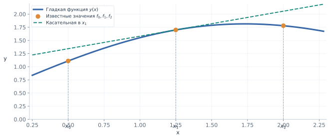
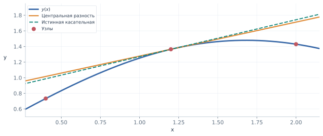
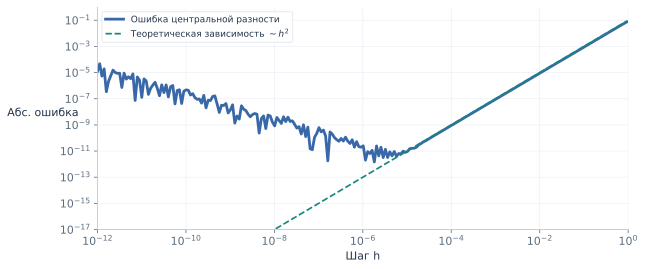

# Численное дифференцирование

ЧИСЛЕННЫЕ МЕТОДЫ · ГЛАВА 02

Численная производная по табличным данным. Переход от определения производной к интерполяционному многочлену Лагранжа, подробный вывод формул первой и второй производных и анализ их точности.

Производная · Многочлен Лагранжа · Шаг сетки h

## 1. Почему возникает задача численного дифференцирования

В лекции дифференцирование начинается с **определения производной**:

$$
\boxed{y'(x)=\lim_{\Delta x\to0}\frac{y(x+\Delta x)-y(x)}{\Delta x}.}
$$

Если функция $y(x)$ задана аналитическим выражением, производную можно искать обычными правилами дифференцирования. Но иногда доступны **только значения** функции в отдельных точках:

$$\begin{array}{c|ccc}x & x_0 & x_1 & x_2\\\hline y & f_0 & f_1 & f_2\end{array}.$$

Здесь, сохраняя обозначения конспекта, $f_0,f_1,f_2$ — табличные значения $y(x_0),y(x_1),y(x_2)$. В таком случае непосредственный переход к пределу невозможен: нет доступа к значениям $y(x+\Delta x)$ для произвольно малых $\Delta x$. Задача состоит в приближённом определении $y'(x)$ и $y''(x)$ по имеющимся данным.

{width=95%}

### 1.1. Почему нельзя просто положить $\Delta x=0$

Выражение $\dfrac{y(x+\Delta x)-y(x)}{\Delta x}$ при $\Delta x=0$ не определено: в числителе и знаменателе возникает нуль. Даже если $y$ гладкая, для численного вычисления выбирают **конечный шаг** $h$ и используют несколько известных значений функции.

Если известны значения $y(x)$ и $y(x+h)$, можно взять

$$y'(x)\approx\frac{y(x+h)-y(x)}{h}.$$

Это простая правая разность. В исходной записи используется более содержательный путь: сначала строится **интерполяционный многочлен Лагранжа**, а затем он дифференцируется.

::: {.explain}
**Геометрический смысл.** Разность $(y(x+h)-y(x))/h$ — угловой коэффициент секущей, проходящей через две точки графика. Производная — наклон касательной. При малом $h$ секущая приближается к касательной, но неизбежно появляется погрешность из-за конечного размера шага.
:::

## 2. Интерполяционный многочлен Лагранжа по трём узлам

Рассмотрим три различных узла $x_0,x_1,x_2$ и соответствующие табличные значения $f_0,f_1,f_2$. Ищем многочлен второй степени, проходящий через все три точки:

$$P_2(x_0)=f_0,\qquad P_2(x_1)=f_1,\qquad P_2(x_2)=f_2.$$

В форме Лагранжа он записывается **точно в структуре, используемой в лекции**:

$$
\boxed{\begin{aligned}
P_2(x)={}&\frac{(x-x_1)(x-x_2)}{(x_0-x_1)(x_0-x_2)}f_0\\[5pt]
&+\frac{(x-x_0)(x-x_2)}{(x_1-x_0)(x_1-x_2)}f_1\\[5pt]
&+\frac{(x-x_0)(x-x_1)}{(x_2-x_0)(x_2-x_1)}f_2.
\end{aligned}}
$$

Если в формуле поставить $x=x_0$, второй и третий члены зануляются, первый принимает значение $f_0$. Аналогично при $x=x_1$ остаётся $f_1$, а при $x=x_2$ — $f_2$. Отсюда следует выполнение условий интерполяции.

::: {.explain}
**Почему в числителях стоят произведения $(x-x_j)$?** Например, первый базисный множитель должен быть равен единице в $x_0$ и нулю в $x_1$ и $x_2$. Для получения нулей достаточно множителей $(x-x_1)(x-x_2)$, а деление на $(x_0-x_1)(x_0-x_2)$ нормирует значение в $x_0$ до единицы.
:::

## 3. Дифференцирование многочлена Лагранжа

Раз $P_2(x)$ приближает $y(x)$, естественно приблизить производную функцией $P'_2(x)$. Важно: в конечной формуле это **приближённая производная исходной функции**, хотя производная самого многочлена вычисляется точно.

### 3.1. Производная первого слагаемого

В первом слагаемом знаменатель и $f_0$ постоянны относительно $x$:

$$
\frac{d}{dx}\left[\frac{(x-x_1)(x-x_2)}{(x_0-x_1)(x_0-x_2)}f_0\right]
=\frac{f_0}{(x_0-x_1)(x_0-x_2)}\frac{d}{dx}[(x-x_1)(x-x_2)].
$$

По правилу произведения:

$$
\frac{d}{dx}[(x-x_1)(x-x_2)]
=(x-x_2)+(x-x_1)=2x-x_1-x_2.
$$

Поэтому результат равен

$$\frac{2x-x_1-x_2}{(x_0-x_1)(x_0-x_2)}f_0.$$

### 3.2. Производная второго слагаемого

Для второго слагаемого:

$$
\frac{d}{dx}[(x-x_0)(x-x_2)]
=(x-x_2)+(x-x_0)=2x-x_0-x_2,
$$

откуда

$$\frac{2x-x_0-x_2}{(x_1-x_0)(x_1-x_2)}f_1.$$

### 3.3. Производная третьего слагаемого

Аналогично,

$$
\frac{d}{dx}[(x-x_0)(x-x_1)]
=(x-x_1)+(x-x_0)=2x-x_0-x_1,
$$

поэтому третья часть равна

$$\frac{2x-x_0-x_1}{(x_2-x_0)(x_2-x_1)}f_2.$$

Складывая три результата, получаем полную формулу, выведенную в конспекте:

$$
\boxed{\begin{aligned}
P_2'(x)={}&\frac{2x-x_1-x_2}{(x_0-x_1)(x_0-x_2)}f_0\\[5pt]
&+\frac{2x-x_0-x_2}{(x_1-x_0)(x_1-x_2)}f_1\\[5pt]
&+\frac{2x-x_0-x_1}{(x_2-x_0)(x_2-x_1)}f_2.
\end{aligned}}
$$

В дальнейшем используют приближение $y'(x)\approx P_2'(x)$.

## 4. Равноотстоящие узлы и шаг $h$

В тетради после общего выражения вводится равномерный шаг:

$$\boxed{x_1-x_0=h,\qquad x_2-x_1=h,\qquad h>0.}$$

Таким образом, $x_1=x_0+h$, $x_2=x_0+2h$. Следовательно,

$$\begin{gathered}
x_0-x_1=-h,\qquad x_0-x_2=-2h,\\
x_1-x_0=h,\quad x_1-x_2=-h,\\
x_2-x_0=2h,\qquad x_2-x_1=h.
\end{gathered}$$

Знаменатели трёх слагаемых из предыдущего раздела становятся

$$
(x_0-x_1)(x_0-x_2)=2h^2,\quad
(x_1-x_0)(x_1-x_2)=-h^2,\quad
(x_2-x_0)(x_2-x_1)=2h^2.
$$

Итак,

$$
\boxed{\begin{aligned}
P_2'(x)={}&\frac{2x-x_1-x_2}{2h^2}f_0\\
&-\frac{2x-x_0-x_2}{h^2}f_1\\
&+\frac{2x-x_0-x_1}{2h^2}f_2.
\end{aligned}}
$$

## 5. Первая производная в центральном узле $x_1$

В исходной записи подробно рассматривается подстановка $x=x_1$. Сделаем её явно:

$$
P_2'(x_1)=\frac{x_1-x_2}{2h^2}f_0
-\frac{2x_1-x_0-x_2}{h^2}f_1
+\frac{x_1-x_0}{2h^2}f_2.
$$

Из равномерности сетки следует:

$$x_1-x_2=-h,\qquad 2x_1-x_0-x_2=0,\qquad x_1-x_0=h.$$

Подставляем:

$$
P_2'(x_1)=\frac{-h}{2h^2}f_0-\frac{0}{h^2}f_1+\frac{h}{2h^2}f_2
=-\frac{f_0}{2h}+\frac{f_2}{2h}.
$$

Получена **центральная разностная формула**, которая соответствует результату тетради:

$$\boxed{y'(x_1)\approx\frac{f_2-f_0}{2h}.}$$

{width=95%}

::: {.explain}
**Почему в итоге исчезло $f_1$?** При симметричном размещении $x_0=x_1-h$ и $x_2=x_1+h$ вклад среднего узла в производную интерполяционного квадратичного многочлена обнуляется. Именно симметрия позволяет получить формулу второго порядка точности.
:::

## 6. Первая производная в крайних узлах

В конце страницы с центральной разностью упоминаются $y'(x_0)$ и $y'(x_2)$. Восстановим оба вывода из **того же выражения** $P_2'(x)$; новых обозначений для функции вводить не будем.

### 6.1. Левый узел $x_0$

Ставим $x=x_0$:

$$
P_2'(x_0)=\frac{2x_0-x_1-x_2}{2h^2}f_0
-\frac{x_0-x_2}{h^2}f_1
+\frac{x_0-x_1}{2h^2}f_2.
$$

С учётом $x_1=x_0+h$, $x_2=x_0+2h$:

$$
2x_0-x_1-x_2=-3h,\quad x_0-x_2=-2h,\quad x_0-x_1=-h.
$$

Следовательно,

$$
\boxed{y'(x_0)\approx P_2'(x_0)
=-\frac{3f_0}{2h}+\frac{2f_1}{h}-\frac{f_2}{2h}
=\frac{-3f_0+4f_1-f_2}{2h}.}
$$

Это **трёхточечная односторонняя формула** по правым соседям.

### 6.2. Правый узел $x_2$

Аналогично подставляем $x=x_2$:

$$
P_2'(x_2)=\frac{x_2-x_1}{2h^2}f_0
-\frac{x_2-x_0}{h^2}f_1
+\frac{2x_2-x_0-x_1}{2h^2}f_2.
$$

Здесь $x_2-x_1=h$, $x_2-x_0=2h$, $2x_2-x_0-x_1=3h$. Поэтому

$$
\boxed{y'(x_2)\approx P_2'(x_2)
=\frac{f_0-4f_1+3f_2}{2h}.}
$$

Обе односторонние формулы используют все три исходных значения и не требуют вычислений вне имеющегося отрезка $[x_0,x_2]$.

## 7. Приближение второй производной

В исходной записи на следующей странице рассматривается **вторая производная** интерполяционного многочлена. Проделаем дифференцирование ещё раз:

$$
P_2'(x)=\frac{2x-x_1-x_2}{2h^2}f_0
-\frac{2x-x_0-x_2}{h^2}f_1
+\frac{2x-x_0-x_1}{2h^2}f_2.
$$

Поскольку производные числителей $2x-\mathrm{const}$ равны $2$, находим

$$
\begin{aligned}
P_2''(x)&=\frac{2}{2h^2}f_0-\frac{2}{h^2}f_1+\frac{2}{2h^2}f_2\\[4pt]
&=\frac{f_0}{h^2}-\frac{2f_1}{h^2}+\frac{f_2}{h^2}.
\end{aligned}
$$

Итоговая формула:

$$\boxed{y''(x_1)\approx\frac{f_0-2f_1+f_2}{h^2}.}$$

Производная $P_2''$ от квадратичного многочлена постоянна, но **истинная** $y''(x)$ на отрезке вообще говоря непостоянна. Поэтому формулу второго порядка применяют прежде всего к **центральному узлу $x_1$**.

::: {.correction}
**Математически важное уточнение.** Равенство $P_2''(x)=\frac{f_0-2f_1+f_2}{h^2}$ точно для интерполяционного многочлена. Для самой функции необходимо ставить **знак приближённого равенства**: $y''(x_1)\approx P_2''(x_1)$. Приписывать это значение истинной второй производной при любом $x$ нельзя.
:::

## 8. Откуда берётся погрешность разностных формул

Этот раздел — **дополнительное объяснение** к лекционному выводу. Чтобы оценить точность, разложим значения гладкой функции в ряд Тейлора около $x_1$:

$$\begin{aligned}
y(x_1+h)&=y(x_1)+hy'(x_1)+\frac{h^2}{2}y''(x_1)
+\frac{h^3}{6}y'''(x_1)+\frac{h^4}{24}y^{(4)}(x_1)+\cdots,\\[4pt]
y(x_1-h)&=y(x_1)-hy'(x_1)+\frac{h^2}{2}y''(x_1)
-\frac{h^3}{6}y'''(x_1)+\frac{h^4}{24}y^{(4)}(x_1)-\cdots.
\end{aligned}$$

### 8.1. Погрешность центральной первой производной

Вычитаем вторую строку из первой. Чётные степени $h$ уничтожаются:

$$y(x_1+h)-y(x_1-h)=2hy'(x_1)+\frac{h^3}{3}y'''(x_1)+O(h^5).$$

Делим на $2h$:

$$\frac{f_2-f_0}{2h}=y'(x_1)+\frac{h^2}{6}y'''(x_1)+O(h^4).$$

То есть центральная формула имеет **погрешность порядка $O(h^2)$** при достаточной гладкости функции.

### 8.2. Погрешность второй производной

Теперь сложим разложения и вычтем $2y(x_1)$:

$$y(x_1+h)-2y(x_1)+y(x_1-h)=h^2y''(x_1)+\frac{h^4}{12}y^{(4)}(x_1)+O(h^6).$$

Разделив на $h^2$, получаем

$$\frac{f_0-2f_1+f_2}{h^2}=y''(x_1)+\frac{h^2}{12}y^{(4)}(x_1)+O(h^4).$$

Таким образом, центральная формула второй производной также имеет точность $O(h^2)$.

### 8.3. Погрешность трёхточечных односторонних формул

По аналогичному разложению Тейлора оказывается, что

$$\frac{-3f_0+4f_1-f_2}{2h}=y'(x_0)-\frac{h^2}{3}y'''(x_0)+O(h^3),$$

$$\frac{f_0-4f_1+3f_2}{2h}=y'(x_2)-\frac{h^2}{3}y'''(x_2)+O(h^3).$$

Старший член ошибки также пропорционален $h^2$. В отличие от центральной формулы, односторонние формулы асимметричны, и следующие члены ошибки могут иметь порядок $h^3$.

### 8.4. Почему слишком маленький $h$ бывает вреден

При вычислениях в конечной арифметике возникают не только ошибки замены производной конечной разностью, но и ошибки округления: близкие значения $f_2$ и $f_0$ вычитаются, а разность делится на маленький $h$. Поэтому уменьшение $h$ сначала может улучшать ответ, но затем начинает усиливать влияние округления и шума в таблице.

{width=95%}

::: {.note}
**Практический математический смысл.** Численное дифференцирование обычно чувствительнее к погрешностям исходных данных, чем численное интегрирование. Особенно это заметно для второй производной: ошибка в табличных значениях делится на $h^2$.
:::

### 8.5. О размере малого приращения

В рукописи встречается пример малого приращения вида $\Delta x=10^{-4}$. Его следует понимать как **иллюстрацию** малого числа, а не как универсально оптимальный шаг. В реальных вычислениях подходящий $h$ зависит от гладкости функции, масштаба аргумента, точности исходных данных и арифметики компьютера.

Кроме того, полученные конечные разности позволяют **приближать производные в дифференциальных уравнениях**. Например, формальная замена $y''(x_i)\approx (y_{i-1}-2y_i+y_{i+1})/h^2$ переводит задачу с производной в соотношение между значениями функции на сетке. Это объясняет, почему численное дифференцирование применяется и в численных методах решения ОДУ и уравнений в частных производных.

## 9. Сводка формул

Для **равномерной трёхточечной сетки** $x_1-x_0=x_2-x_1=h$:

| Что приближаем | Формула |
|---|---|
| Первая производная при $x_0$ | $\displaystyle y'(x_0)\approx\frac{-3f_0+4f_1-f_2}{2h}$ |
| Первая производная при $x_1$ | $\displaystyle y'(x_1)\approx\frac{f_2-f_0}{2h}$ |
| Первая производная при $x_2$ | $\displaystyle y'(x_2)\approx\frac{f_0-4f_1+3f_2}{2h}$ |
| Вторая производная при $x_1$ | $\displaystyle y''(x_1)\approx\frac{f_0-2f_1+f_2}{h^2}$ |

Все приведённые формулы вытекают из интерполяционного многочлена **второй степени** по трём узлам. Необходимо различать производную многочлена (точную) и приближение производной исходной функции (приближённое).

Далее: <a href="03-integration.qmd">численное интегрирование →</a>

