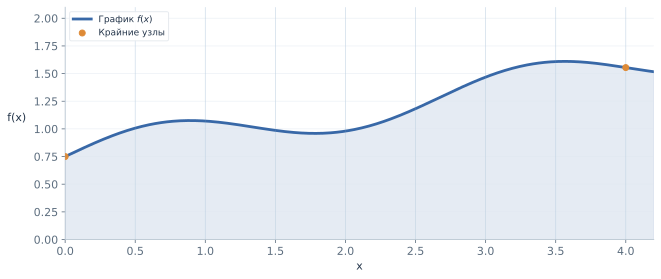
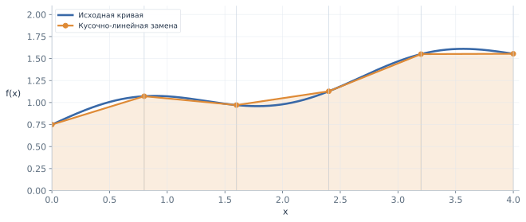
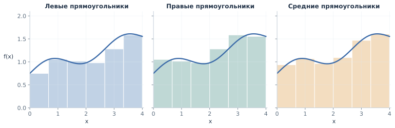
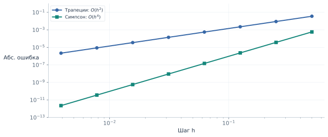
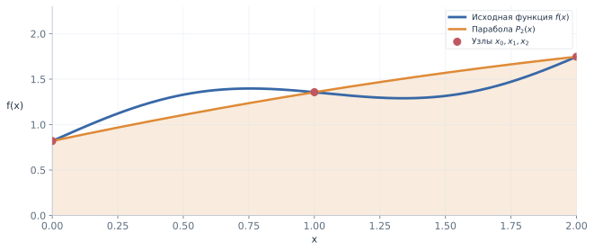

# Численное интегрирование

ЧИСЛЕННЫЕ МЕТОДЫ · ГЛАВА 03

Как по таблично заданной функции приближённо вычислить определённый интеграл. Методы трапеций, прямоугольников, Симпсона, анализ шага и оценка погрешности методом Рунге–Ромберга.

Квадратурные формулы · Шаг $h$ · Симпсон · Уточнение по Рунге

## 1. Табличная задача интегрирования

На следующей лекции рассматривается таблица значений функции

$$\begin{array}{c|ccccc}x&x_0&x_1&\cdots&x_{n-1}&x_n\\\hline f&f_0&f_1&\cdots&f_{n-1}&f_n\end{array}$$

и требуется вычислить приближённое значение интеграла по отрезку $[x_0,x_n]$:

$$\boxed{I=\int_{x_0}^{x_n}f(x)\,dx.}$$

Если аналитическая формула $f(x)$ неизвестна, нельзя просто найти первообразную. Поэтому интеграл **заменяют суммой площадей простых фигур**, построенных по известным значениям функции.

{width=95%}

Интеграл геометрически соответствует **ориентированной площади** между графиком и осью $x$. Если $f(x)>0$, вклад положителен; если $f(x)<0$, вклад отрицателен. Поэтому при вычислении площади геометрической фигуры берут модуль, а в определённом интеграле — учитывают знак функции.

### 1.1. Замечание о симметрии функции

В исходной лекции есть графическое замечание о поведении интеграла для симметричного участка кривой. Если $f$ **нечётна**, то есть $f(-x)=-f(x)$, на симметричном отрезке $[-a,a]$ положительные и отрицательные вклады взаимно компенсируются:

$$\boxed{\int_{-a}^{a}f(x)\,dx=0.}$$

Например, $\int_{-\pi/2}^{\pi/2}\sin x\,dx=0$. Важно не спутать это со случаем **чётной** функции $f(-x)=f(x)$, для которой $\int_{-a}^{a}f(x)\,dx=2\int_0^a f(x)\,dx$.

### 1.2. Разбиение отрезка на части

Узлы упорядочены:

$$x_0<x_1<\cdots<x_n.$$

Обозначим ширину $i$-го подынтервала через

$$\boxed{h_i=x_i-x_{i-1},\qquad i=1,2,\ldots,n.}$$

Если расстояния между соседними узлами одинаковы, то $h_1=\cdots=h_n=h$ и

$$\boxed{h=\frac{x_n-x_0}{n},\qquad x_i=x_0+ih.}$$

Обратите внимание: здесь $n$ — число **подынтервалов**, а точек $n+1$. Это важно для правильного числа слагаемых в суммах.

::: {.explain}
**Основной приём всех квадратурных формул.** На каждом маленьком отрезке сложную кривую заменяют простой фигурой или многочленом. Для прямоугольников — константой, для трапеций — прямой, для Симпсона — параболой. Затем суммируют полученные интегралы.
:::

## 2. Метод трапеций — основной метод лекции

В исходном конспекте первым подробно выводится **метод трапеций**. Между соседними узлами $x_{i-1}$ и $x_i$ график функции приближённо заменяем прямолинейным отрезком. Под этой прямой образуется трапеция высоты $h_i$ с основаниями $f_{i-1}$ и $f_i$ (если обе ординаты положительны).

{width=95%}

### 2.1. Интеграл на одном подынтервале

Площадь соответствующей трапеции:

$$\boxed{S_i=\frac{f_{i-1}+f_i}{2}\,h_i.}$$

Для произвольных знаков $f_i$ та же формула вычисляет **ориентированный интеграл от линейной интерполяции**, а не обычную геометрическую площадь.

Приближение интеграла по всей таблице получаем суммированием:

$$
\boxed{I\approx S_{\text{тр}}=
\sum_{i=1}^{n}\frac{f_{i-1}+f_i}{2}(x_i-x_{i-1}).}
$$

Это составная формула трапеций для **неравномерных узлов**; она точно соответствует геометрической идее исходной лекции.

### 2.2. Равномерный шаг

Если все $h_i=h$, то

$$
S_{\text{тр}}=h\sum_{i=1}^{n}\frac{f_{i-1}+f_i}{2}
=\frac{h}{2}\big[(f_0+f_1)+(f_1+f_2)+\cdots+(f_{n-1}+f_n)\big].
$$

Раскроем скобки и сгруппируем одинаковые значения: внутренние ординаты $f_1,\ldots,f_{n-1}$ встречаются по два раза, крайние $f_0$ и $f_n$ — по одному:

$$
\begin{aligned}
S_{\text{тр}}&=\frac h2\big[f_0+2f_1+2f_2+\cdots+2f_{n-1}+f_n\big]\\
&=h\left[\frac{f_0}{2}+\sum_{i=1}^{n-1}f_i+\frac{f_n}{2}\right].
\end{aligned}
$$

Итоговая формула из лекции:

$$\boxed{S_{\text{тр}}=h\left(\frac{f_0+f_n}{2}+\sum_{i=1}^{n-1}f_i\right).}$$

::: {.explain}
**Почему у крайних значений коэффициент $\frac12$?** Точка $x_0$ принадлежит только первой трапеции, а точка $x_n$ — только последней. Каждая внутренняя точка служит общей вершиной двух соседних трапеций, поэтому её вклад удваивается.
:::

### 2.3. Связь с линейной интерполяцией

На одном промежутке $[x_{i-1},x_i]$ линейная функция, проходящая через концы, записывается как

$$
L_i(x)=\frac{x_i-x}{h_i}f_{i-1}+\frac{x-x_{i-1}}{h_i}f_i.
$$

Интегрирование даёт:

$$
\begin{aligned}
\int_{x_{i-1}}^{x_i}L_i(x)\,dx
&=\frac{f_{i-1}}{h_i}\int_{x_{i-1}}^{x_i}(x_i-x)\,dx
+\frac{f_i}{h_i}\int_{x_{i-1}}^{x_i}(x-x_{i-1})\,dx\\
&=\frac{f_{i-1}}{h_i}\cdot\frac{h_i^2}{2}
+\frac{f_i}{h_i}\cdot\frac{h_i^2}{2}\\
&=\frac{h_i}{2}(f_{i-1}+f_i).
\end{aligned}
$$

Следовательно, трапецеидальная формула не просто геометрический приём: это **точное интегрирование кусочно-линейной интерполяции**.

### 2.4. Погрешность метода трапеций

Дополнительная теоретическая оценка: если $f\in C^2[x_0,x_n]$ и сетка равномерна, то

$$I-S_{\text{тр}}=-\frac{(x_n-x_0)h^2}{12}f''(\xi),\qquad \xi\in(x_0,x_n)$$

при стандартных условиях теоремы о погрешности составной формулы. Отсюда для ограниченной второй производной следует **порядок точности $O(h^2)$**:

$$|I-S_{\text{тр}}|\le\frac{x_n-x_0}{12}h^2\max_{[x_0,x_n]}|f''(x)|.$$

Если $f''(x)>0$ (выпуклая вверх функция), то обычно $S_{\text{тр}}>I$, а при $f''(x)<0$ — наоборот. На гладких функциях уменьшение шага в два раза уменьшает ведущий член ошибки примерно в четыре раза.

## 3. Метод прямоугольников

Следом в конспекте рассматриваются **правые и левые прямоугольники**. На каждом подынтервале строим прямоугольник ширины $h$; его высота выбирается из табличных значений.

{width=95%}

### 3.1. Правые прямоугольники

В качестве высоты на отрезке $[x_{i-1},x_i]$ берём значение на правом конце $f_i$. При равномерном шаге:

$$\boxed{S_{\text{пр}}=h\sum_{i=1}^{n}f_i=h(f_1+f_2+\cdots+f_n).}$$

Если $f(x)$ возрастает, правая сумма для положительной функции даёт завышение ориентированного интеграла; если убывает, — занижение.

### 3.2. Левые прямоугольники

Высота на $[x_{i-1},x_i]$ равна $f_{i-1}$:

$$\boxed{S_{\text{лев}}=h\sum_{i=0}^{n-1}f_i=h(f_0+f_1+\cdots+f_{n-1}).}$$

Для возрастающей функции левая сумма меньше точного интеграла, а для убывающей — больше.

### 3.3. Связь левых и правых прямоугольников с трапециями

Складываем обе формулы:

$$
S_{\text{лев}}+S_{\text{пр}}
=h\left[f_0+2\sum_{i=1}^{n-1}f_i+f_n\right].
$$

После деления на $2$ получаем

$$
\frac{S_{\text{лев}}+S_{\text{пр}}}{2}
=h\left[\frac{f_0+f_n}{2}+\sum_{i=1}^{n-1}f_i\right]
=S_{\text{тр}}.
$$

Таким образом, записанное в лекции соотношение:

$$\boxed{S_{\text{тр}}=\frac{S_{\text{лев}}+S_{\text{пр}}}{2}}$$

является **точным алгебраическим тождеством** для одной и той же равномерной сетки.

### 3.4. Средние прямоугольники

Метод средних прямоугольников также указан в конспекте. На каждом отрезке $[x_{i-1},x_i]$ высота выбирается в **середине**, поэтому

$$\boxed{S_{\text{ср}}=h\sum_{i=1}^{n}f\!\left(\frac{x_{i-1}+x_i}{2}\right).}$$

Здесь требуется уметь вычислять функцию в серединах промежутков. Если исходные данные содержат **только значения в узлах** $x_0,\ldots,x_n$, то средние значения заранее неизвестны: нужно дополнительно измерить функцию или построить приближение.

::: {.correction}
**Важное уточнение к формуле средних прямоугольников.** Нельзя подменять высоту $f\!\left((x_{i-1}+x_i)/2\right)$ средним значением $\tfrac12(f_{i-1}+f_i)$ без оговорок. Второе выражение соответствует **трапеции**, а не общему методу средних прямоугольников. Они совпадают для линейной функции на отрезке, но отличаются для криволинейной функции.
:::

### 3.5. Точность прямоугольников

Для гладких функций при равномерном шаге левые и правые прямоугольники имеют погрешность обычно порядка $O(h)$. Средние прямоугольники — порядка $O(h^2)$:

$$I-S_{\text{ср}}=\frac{(x_n-x_0)h^2}{24}f''(\xi),\qquad \xi\in(x_0,x_n),$$

для $f\in C^2[x_0,x_n]$.

Тот факт, что метод средних прямоугольников обычно точнее простых левых и правых, связан с симметрией выбора точки внутри каждого подынтервала.

## 4. Шаг разбиения и оценка погрешности

В конспекте вводятся две аппроксимации интеграла: на сетке с шагом $h$ и на сетке с вдвое меньшим шагом $h/2$. Обозначим их так же, как в записи:

$$\boxed{S=S(h),\qquad S_1=S(h/2).}$$

Интуиция проста: меньший шаг даёт больше трапеций или прямоугольников, каждая из которых лучше приближает соответствующий небольшой участок кривой. Однако **малость разности двух приближений не всегда гарантирует малость истинной ошибки**, если неизвестен характер сходимости.

В лекции рассмотрено условие вида

$$\boxed{\left|S(h)-S\!\left(\frac h2\right)\right|<\varepsilon,\qquad\varepsilon>0,}$$

где $\varepsilon$ — требуемая малая величина. Это распространённый **критерий остановки**, основанный на последовательном измельчении сетки.

{width=95%}

::: {.explain}
**Почему сравнивают именно $h$ и $h/2$?** При делении шага пополам сетки удобно совмещать: все старые узлы остаются, между ними добавляется по одному новому. Кроме того, известное отношение шагов $2$ делает простой оценку ведущего члена ошибки.
:::

## 5. Метод Рунге–Ромберга

В рукописи сразу после сравнения $S(h)$ и $S(h/2)$ вводится формула оценки погрешности через **порядок точности $p$**. Этот приём известен как метод Рунге–Ромберга (часто — Рунге–Ромберга–Ричардсона).

### 5.1. Предположение о главном члене ошибки

Пусть $I$ — точное значение интеграла. Для некоторого квадратурного метода предполагаем асимптотическую формулу

$$\boxed{I=S(h)+C h^p+O(h^{p+1}),}$$

где $C$ зависит от функции и метода, но не от $h$ в ведущем приближении, а $p$ — порядок точности.

На шаге $h/2$:

$$
I=S\!\left(\frac h2\right)+C\left(\frac h2\right)^p+O(h^{p+1})
=S\!\left(\frac h2\right)+\frac{C h^p}{2^p}+O(h^{p+1}).
$$

Для прозрачности вывода сначала временно отбросим остатки более высокого порядка:

$$\begin{cases}
I\approx S(h)+Ch^p,\\
I\approx S(h/2)+\dfrac{Ch^p}{2^p}.
\end{cases}$$

### 5.2. Вывод выражения для ошибки

Вычитаем второе равенство из первого:

$$
0\approx S(h)-S(h/2)+Ch^p\left(1-\frac1{2^p}\right).
$$

Отсюда

$$
Ch^p\approx\frac{S(h/2)-S(h)}{1-2^{-p}}.
$$

При этом ошибка **более точного результата** $S(h/2)$ составляет примерно

$$
\frac{Ch^p}{2^p}
\approx\frac{S(h/2)-S(h)}{2^p-1}.
$$

Итоговая формула для оценки абсолютной погрешности:

$$\boxed{\Delta_{h/2}\approx\frac{|S(h/2)-S(h)|}{2^p-1}.}$$

Это ключевой результат вывода в конспекте; условие его применимости — наличие асимптотического режима с **известным порядком $p$**.

### 5.3. Уточнённое приближение интеграла

Можно не только оценить ошибку, но и скорректировать результат. Из формулы для ошибки $S(h/2)$:

$$
\boxed{I\approx S_{\text{уточн}}=S(h/2)+\frac{S(h/2)-S(h)}{2^p-1}.}
$$

Это *экстраполяция Ричардсона*: за счёт двух вычислений с разными шагами устраняется ведущий член ошибки $Ch^p$.

::: {.correction}
**Точность записи остатка.** В конспекте при преобразованиях с $O(h^p)$ важно различать $O(h^p)$ (главный порядок ошибки исходного метода) и **остаток после его устранения**. Если асимптотическое разложение содержит следующий член порядка $h^{p+1}$, уточнённое значение обычно получает ошибку $O(h^{p+1})$. Для симметричных квадратурных формул следующий ненулевой член нередко имеет порядок $h^{p+2}$, но это требует дополнительных условий гладкости.
:::

### 5.4. Что подставлять вместо $p$

| Формула | Типичный порядок глобальной погрешности |
|---|---|
| Левые прямоугольники | $p=1$ |
| Правые прямоугольники | $p=1$ |
| Средние прямоугольники | $p=2$ |
| Трапеции | $p=2$ |
| Симпсон при достаточно гладкой функции | $p=4$ |

Например, для трапеций $2^p-1=3$, а для Симпсона — $15$.

## 6. Метод Симпсона: интегрирование параболы

Последний крупный способ, который обсуждается в лекции по интегрированию, — **метод Симпсона**. Его идея: на трёх соседних узлах заменить функцию не прямой, а **интерполяционным многочленом второй степени**.

В исходной записи на страницах с выводом метода Симпсона приведён именно многочлен Лагранжа:

$$
\boxed{\begin{aligned}
P_2(x)={}&\frac{(x-x_1)(x-x_2)}{(x_0-x_1)(x_0-x_2)}f_0\\
&+\frac{(x-x_0)(x-x_2)}{(x_1-x_0)(x_1-x_2)}f_1\\
&+\frac{(x-x_0)(x-x_1)}{(x_2-x_0)(x_2-x_1)}f_2.
\end{aligned}}
$$

{width=95%}

### 6.1. Условие равномерного шага

Предполагаем

$$x_1=x_0+h,\quad x_2=x_0+2h,\quad x_2-x_0=2h.$$

Вместо непосредственного интегрирования громоздких выражений с $x_0,x_1,x_2$ введём **только внутри вычисления** переменную $t=(x-x_0)/h$. Тогда $x=x_0+ht$, $dx=h\,dt$, а три узла соответствуют $t=0,1,2$.

В новых координатах интерполяционный многочлен преобразуется в

$$
P_2(x_0+ht)=\frac{(t-1)(t-2)}{2}f_0-t(t-2)f_1+\frac{t(t-1)}{2}f_2.
$$

Это та же парабола, просто с более удобной переменной интегрирования. Искомая квадратурная формула:

$$
\int_{x_0}^{x_2}f(x)\,dx
\approx\int_{x_0}^{x_2}P_2(x)\,dx
=h\int_0^2P_2(x_0+ht)\,dt.
$$

### 6.2. Интегрирование каждого слагаемого

Первый базисный многочлен:

$$
\int_0^2\frac{(t-1)(t-2)}{2}\,dt
=\frac12\int_0^2(t^2-3t+2)\,dt
=\frac12\left[\frac{t^3}{3}-\frac{3t^2}{2}+2t\right]_0^2
=\frac13.
$$

Второй:

$$
\int_0^2[-t(t-2)]\,dt
=\int_0^2(-t^2+2t)\,dt
=\left[-\frac{t^3}{3}+t^2\right]_0^2
=\frac43.
$$

Третий:

$$
\int_0^2\frac{t(t-1)}{2}\,dt
=\frac12\int_0^2(t^2-t)\,dt
=\frac12\left[\frac{t^3}{3}-\frac{t^2}{2}\right]_0^2
=\frac13.
$$

Собираем слагаемые и возвращаем множитель $h$:

$$
\boxed{\int_{x_0}^{x_2}f(x)\,dx
\approx S_{\text{Симпсон}}=\frac h3(f_0+4f_1+f_2).}
$$

Это **формула Симпсона на двух подынтервалах**.

::: {.explain}
**Почему коэффициенты $1,4,1$?** Это не эмпирический выбор. После интегрирования трёх базисных многочленов Лагранжа получаются коэффициенты $\tfrac13$, $\tfrac43$, $\tfrac13$ при общем множителе $h$. Центральное значение имеет больший вес, потому что форма параболы в середине интервала влияет на площадь сильнее.
:::

### 6.3. Составная формула Симпсона

Если весь отрезок делится на **чётное** число $n$ одинаковых подынтервалов, объединяем их по два: $[x_0,x_2]$, $[x_2,x_4]$, …, $[x_{n-2},x_n]$.

Для первой пары вклад равен $\frac h3(f_0+4f_1+f_2)$, для второй — $\frac h3(f_2+4f_3+f_4)$ и т. д. Суммируя и объединяя повторяющиеся значения, получим

$$
\boxed{S_{\text{Симпсон}}=
\frac h3\left[f_0+f_n
+4\sum_{\substack{i=1\\i\,\text{нечёт}}}^{n-1}f_i
+2\sum_{\substack{i=2\\i\,\text{чёт}}}^{n-2}f_i\right],\qquad n\text{ чётно}.}
$$

Для внутренних узлов с нечётными индексами коэффициент $4$, с внутренними чётными индексами — $2$; концы входят с коэффициентом $1$.

### 6.4. Погрешность Симпсона

При $f\in C^4[x_0,x_n]$ для равномерной сетки известна оценка (при существовании соответствующей промежуточной точки $\xi$):

$$
I-S_{\text{Симпсон}}=-\frac{x_n-x_0}{180}h^4 f^{(4)}(\xi).
$$

Следовательно, погрешность составного метода — порядка $O(h^4)$. Симпсон точно интегрирует **многочлены степени не выше трёх**, хотя строится через параболу второй степени; это следствие симметрии расположения узлов.

## 7. Иллюстрация различий между формулами

::: {.example}
**Поясняющий численный пример.** Возьмём $f(x)=x^2$ на $[0,2]$, шаг $h=1$ и узлы $x_0=0$, $x_1=1$, $x_2=2$. Тогда $f_0=0$, $f_1=1$, $f_2=4$, а точное значение интеграла:

$$I=\int_0^2x^2\,dx=\left[\frac{x^3}{3}\right]_0^2=\frac83.$$

Левые прямоугольники: $S_{\text{лев}}=1(0+1)=1$.

Правые: $S_{\text{пр}}=1(1+4)=5$.

Трапеции: $S_{\text{тр}}=\frac{1+5}{2}=3$.

Средние прямоугольники: $S_{\text{ср}}=1[(\tfrac12)^2+(\tfrac32)^2]=\frac52$.

Симпсон: $S_{\text{Симпсон}}=\frac13(0+4\cdot1+4)=\frac83=I$.

Это показывает, почему Симпсон воспроизводит квадратичную функцию точно, а трапеции и прямоугольники — лишь приближённо.
:::

## 8. Что необходимо помнить

1. Задача интегрирования по таблице — найти $\int_{x_0}^{x_n}f(x)\,dx$, не зная аналитического выражения для $f$.
2. Метод трапеций заменяет функцию линейной интерполяцией на каждом подынтервале.
3. При равномерном шаге $S_{\text{тр}}=h\big(\frac{f_0+f_n}{2}+\sum_{i=1}^{n-1}f_i\big)$.
4. Левые и правые прямоугольники используют значения соответственно на левых или правых концах; их среднее равно сумме трапеций.
5. Средние прямоугольники требуют значений **в серединах** промежутков.
6. Метод Симпсона интегрирует интерполяционную параболу и на двух шагах даёт $\frac h3(f_0+4f_1+f_2)$.
7. Уменьшение шага и сравнение $S(h)$ с $S(h/2)$ позволяют контролировать сходимость.
8. При известном порядке $p$ метод Рунге–Ромберга даёт оценку погрешности $\frac{|S(h/2)-S(h)|}{2^p-1}$.

Далее: <a href="04-ode.qmd">численное решение задачи Коши →</a>

