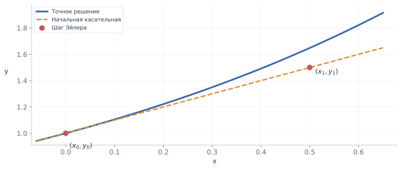
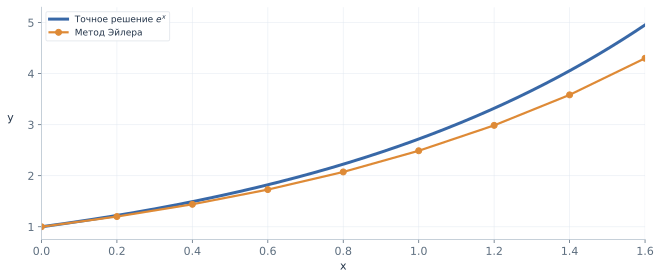
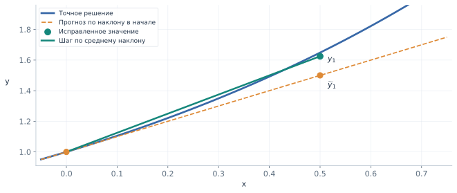
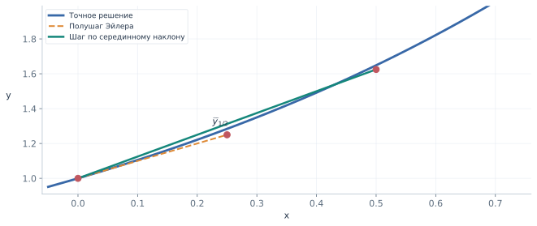
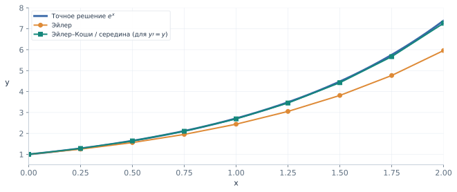

# Задача Коши и методы Эйлера

ЧИСЛЕННЫЕ МЕТОДЫ · ГЛАВА 04

Численное решение обыкновенного дифференциального уравнения первого порядка с начальным условием. Геометрический смысл наклона касательной, явный метод Эйлера, исправленный метод Эйлера–Коши и метод средней точки.

ОДУ · Задача Коши · Эйлер · Эйлер–Коши

## 1. Задача Коши для обыкновенного дифференциального уравнения

В последней части конспекта рассматривается задача численного решения **дифференциального уравнения**. Исходная постановка задаётся двумя соотношениями:

$$
\boxed{\begin{cases}
\displaystyle\frac{dy}{dx}=f(x,y),\\[5pt]
y(x_0)=y_0.
\end{cases}}
$$

Здесь $f(x,y)$ — **заданная функция двух переменных**, определяющая скорость изменения искомой функции $y(x)$. В этой главе запись $f(x,y)$ имеет другой смысл, чем табличные значения $f_i$ в предыдущих главах, и этот переход соответствует теме самой лекции.

Решение $y(x)$ должно удовлетворять одновременно уравнению $y'(x)=f(x,y(x))$ и **начальному условию** $y(x_0)=y_0$.

### 1.1. Чем задача Коши отличается от обычного интегрирования

При интегрировании по известной функции $f(x)$ вычисляют определённый интеграл. В задаче Коши неизвестная функция $y(x)$ входит в правую часть через $f(x,y)$, то есть чтобы узнать её производную, требуется знать **само текущее значение решения**.

Например, уравнение $y'=y$ говорит, что наклон графика в каждой точке равен текущему значению функции. При начальном условии $y(0)=1$ точное решение $y(x)=e^x$, но в общем случае аналитическое решение может быть неизвестно или слишком сложно.

### 1.2. Построение сетки

В лекции требуется найти решение на отрезке $[a,b]$ и строится сетка с постоянным шагом $h$:

$$\boxed{x_i=x_0+i\,h,\qquad i=0,1,\ldots,n,\qquad h=\frac{b-a}{n}.}$$

В стандартной постановке $x_0=a$, $x_n=b$. В исходной записи также отдельно указано соответствие начальной и конечной точек: $a=x_0$, $b=x_n$.

Обозначим численное приближение к значению точного решения в узле $x_i$ через $y_i$:

$$\boxed{y_i\approx y(x_i),\qquad y_0=y(x_0).}$$

Цель численного метода — последовательно получить $y_1,y_2,\ldots,y_n$.

::: {.explain}
**Главное различие обозначений.** $y(x_i)$ — значение **точного** решения, а $y_i$ — **численное приближение**, полученное по рекуррентной формуле. В самом начале $y_0=y(x_0)$ задано точно; на следующих шагах погрешность может накапливаться.
:::

## 2. Геометрический смысл уравнения

Поскольку

$$\frac{dy}{dx}=f(x,y),$$

значение $f(x_0,y_0)$ показывает наклон касательной к неизвестному графику в начальной точке $(x_0,y_0)$:

$$\boxed{f(x_0,y_0)=\left.\frac{dy}{dx}\right|_{x=x_0}.}$$

Если мы не знаем всей кривой, но знаем направление касательной, то можем провести из начальной точки маленький прямолинейный отрезок по этому направлению. Его конец даст первое приближение к кривой.

{width=95%}

Приближение по касательной особенно естественно на коротких отрезках, так как график гладкой функции в малой окрестности точки похож на прямую.

## 3. Явный метод Эйлера

В тетради этот метод записан первым и назван **методом Эйлера**. Для начала используем определение производной в виде конечной разности:

$$
\frac{y_1-y_0}{h}\approx f(x_0,y_0),\qquad h=x_1-x_0.
$$

Умножим на $h$:

$$y_1-y_0\approx hf(x_0,y_0).$$

Переносим $y_0$ вправо (или прибавляем его к обеим частям). Получаем **основную формулу лекции**:

$$\boxed{y_1=y_0+h\,f(x_0,y_0).}$$

Это первое численное значение решения. Чтобы перейти к следующему узлу, используем ту же идею, но уже из точки $(x_1,y_1)$:

$$y_2=y_1+h\,f(x_1,y_1).$$

В общем виде:

$$\boxed{y_{i+1}=y_i+h\,f(x_i,y_i),\qquad i=0,1,\ldots,n-1.}$$

### 3.1. Пошаговая интерпретация

1. Мы знаем текущую точку $(x_i,y_i)$.
2. Вычисляем значение правой части $f(x_i,y_i)$ — приближение наклона решения в этой точке.
3. Умножаем этот наклон на горизонтальное смещение $h$.
4. Прибавляем полученное вертикальное смещение к $y_i$.
5. Переходим к следующей точке $(x_{i+1},y_{i+1})$.

Это **явный** метод: значение $y_{i+1}$ вычисляется непосредственно из уже известных величин.

### 3.2. Геометрическая интерпретация

На каждом шаге строится касательная к приближённой траектории в текущей точке. Затем по этой касательной выполняется шаг длины $h$ по оси $x$. В итоге получается ломаная линия, приближающая решение задачи Коши.

{width=95%}

### 3.3. Разбор одного шага на примере

::: {.example}
**Дополнительная иллюстрация.** Пусть $y'=y$, $y(0)=1$, $h=0{,}2$. Тогда $x_0=0$, $y_0=1$, а $f(x,y)=y$.

По формуле Эйлера

$$y_1=y_0+h f(x_0,y_0)=1+0{,}2\cdot1=1{,}2.$$

В то же время точное значение $y(0{,}2)=e^{0{,}2}\approx1{,}221403$. Следовательно, абсолютная ошибка уже после первого шага примерно $0{,}021403$.

На следующем шаге явного Эйлера $y_2=1{,}2+0{,}2\cdot1{,}2=1{,}44$, тогда как $e^{0{,}4}\approx1{,}491825$.
:::

## 4. Почему метод Эйлера имеет погрешность

Наклон $f(x_i,y_i)$ обычно меняется при движении по отрезку от $x_i$ до $x_{i+1}$. Метод Эйлера предполагает, что **на всём маленьком отрезке** можно пользоваться наклоном, вычисленным только в его начале. Если график изгибается, ломаная отклоняется от точной кривой.

В исходном конспекте это объясняется рисунком с двумя траекториями — прямолинейным продолжением по Эйлеру и более плавным приближением.

### 4.1. Разложение точного решения в ряд Тейлора

Предположим, что решение достаточно гладкое. Тогда

$$
 y(x_i+h)=y(x_i)+hy'(x_i)+\frac{h^2}{2}y''(x_i)+O(h^3).
$$

Поскольку $y'(x_i)=f(x_i,y(x_i))$, имеем

$$
 y(x_i+h)=y(x_i)+h f(x_i,y(x_i))+\frac{h^2}{2}y''(x_i)+O(h^3).
$$

Если бы в формулу Эйлера на шаге подставлялось **точное** начальное значение $y(x_i)$, пропущенный член был бы порядка $h^2$. Это объясняет локальную погрешность одного шага.

### 4.2. Локальная и глобальная погрешности

- **Локальная погрешность одного шага** — разность между точным продвижением от точного значения $y(x_i)$ и одним шагом метода. У явного Эйлера она обычно $O(h^2)$.
- **Глобальная погрешность** — разность между точным решением $y(x_i)$ и реально накопленным приближением $y_i$ после множества шагов. При стандартных условиях гладкости и устойчивости метода она обычно $O(h)$ на фиксированном отрезке.

::: {.note}
**Пояснение к замечанию преподавателя.** В рукописи метод Эйлера назван малоэффективным на практике, поскольку есть более точные способы при близких затратах. В современной практике явный Эйлер всё же используется в учебных задачах и простых моделях, но действительно часто уступает методам более высокого порядка и плохо подходит для жёстких задач.
:::

## 5. Исправленный метод Эйлера — метод Эйлера–Коши

В конспекте следующий способ мотивирован тем, что наклон решения меняется вдоль шага. Поэтому сначала можно приблизительно попасть в конец интервала, оценить там наклон и **усреднить начальный и конечный наклоны**.

### 5.1. Первый этап: прогноз

Как и в явном методе Эйлера, строится предварительное приближение в конце шага:

$$\boxed{\widetilde y_{i+1}=y_i+h\,f(x_i,y_i).}$$

В записи лекции предварительное значение обозначено отдельной пометкой над $y_1$; здесь сохранена идея **временного прогнозного значения** через тильду $\widetilde y_{i+1}$, чтобы не путать его с окончательным результатом $y_{i+1}$.

Используя этот прогноз, находим наклон в правом конце:

$$f(x_{i+1},\widetilde y_{i+1})=f(x_i+h,\widetilde y_{i+1}).$$

### 5.2. Второй этап: коррекция

Вместо наклона только в левой точке берём среднее двух оценок:

$$k_{\text{ср}}=\frac{f(x_i,y_i)+f(x_{i+1},\widetilde y_{i+1})}{2}.$$

Шаг для $y$ равен $h$ умножить на средний наклон:

$$
\boxed{y_{i+1}=y_i+\frac h2\big[f(x_i,y_i)+f(x_{i+1},\widetilde y_{i+1})\big].}
$$

Подставив формулу прогноза $\widetilde y_{i+1}=y_i+h f(x_i,y_i)$, получаем полностью явную двухэтапную схему:

$$
\boxed{\begin{aligned}
\widetilde y_{i+1}&=y_i+h f(x_i,y_i),\\[4pt]
y_{i+1}&=y_i+\frac h2\big[f(x_i,y_i)+f(x_i+h,\widetilde y_{i+1})\big].
\end{aligned}}
$$

Этот метод также известен как **явный метод трапеций**, или метод Хойна, и относится к методам Рунге–Кутты второго порядка. В нашей лекции используется название **«Эйлера–Коши»**.

{width=95%}

::: {.explain}
**Почему улучшение естественно?** Начальный наклон отражает поведение функции только у $x_i$, а прогнозный правый наклон — у $x_{i+1}$. Их среднее лучше приближает среднюю скорость изменения функции на всём шаге. Сходство с методом трапеций не случайно: мы фактически заменяем интеграл от правой части усреднением двух концов.
:::

### 5.3. Пример с уравнением $y'=y$

::: {.example}
Вновь возьмём $y'=y$, $y_0=1$, $h=0{,}2$. Сначала прогнозируем:

$$\widetilde y_1=1+0{,}2\cdot1=1{,}2.$$

Далее усредняем два наклона: в начале он равен $1$, в прогнозном конце — $1{,}2$:

$$y_1=1+\frac{0{,}2}{2}(1+1{,}2)=1{,}22.$$

Точное значение $e^{0{,}2}\approx1{,}221403$. Ошибка исправленного метода на первом шаге приблизительно $0{,}001403$, что значительно меньше ошибки явного Эйлера $0{,}021403$ при том же шаге.
:::

## 6. Метод средней точки (серединная схема)

В завершении конспекта обсуждается ещё один вариант второго порядка. Вместо вычисления наклона на **двух концах** шага попробуем найти его **в середине**.

### 6.1. Предварительный полушаг Эйлера

Сначала движемся от $(x_i,y_i)$ на половину шага $h/2$ с начальным наклоном:

$$\boxed{\widetilde y_{i+1/2}=y_i+\frac h2 f(x_i,y_i).}$$

Это приближение к значению решения в точке $x_i+h/2$.

### 6.2. Полный шаг по срединному наклону

Теперь вычисляем правую часть в середине:

$$f\!\left(x_i+\frac h2,\widetilde y_{i+1/2}\right).$$

И умножаем полученный наклон уже на полный шаг $h$:

$$
\boxed{y_{i+1}=y_i+h\,f\!\left(x_i+\frac h2,\;y_i+\frac h2 f(x_i,y_i)\right).}
$$

В исходной записи это названо вариантом метода Эйлера с пересчётом, использующим значения производной **в середине** отрезка. В литературе схема широко известна как **явный метод средней точки**, второй порядок метода Рунге–Кутты.

{width=95%}

### 6.3. Почему формула имеет второй порядок точности

Дополнительное объяснение через Тейлора. Для точного решения имеем

$$y(x_i+h)=y(x_i)+hy'(x_i)+\frac{h^2}{2}y''(x_i)+O(h^3).$$

Обозначим $f=f(x_i,y(x_i))$. Поскольку $y'=f(x,y)$, по цепному правилу

$$y''=f_x+f_y\,y'=f_x+f_y f.$$

В серединной формуле разложим правую часть по двум аргументам:

$$
 f\!\left(x_i+\frac h2,y_i+\frac h2 f(x_i,y_i)\right)
=f(x_i,y_i)+\frac h2\big[f_x(x_i,y_i)+f_y(x_i,y_i)f(x_i,y_i)\big]+O(h^2).
$$

Умножаем на $h$ и прибавляем $y_i$:

$$
 y_{i+1}=y_i+h f(x_i,y_i)+\frac{h^2}{2}\big[f_x+f_y f\big]+O(h^3).
$$

Получаем первые три члена ряда Тейлора точного решения, поэтому **локальная погрешность одного шага имеет порядок $O(h^3)$**, а **глобальная — $O(h^2)$** при стандартных условиях.

::: {.correction}
**Не путать две схемы.** Усреднение $\frac12[f(x_i,y_i)+f(x_i+h,\widetilde y_{i+1})]$ — это метод Эйлера–Коши (явный метод трапеций). Вычисление одного наклона в середине с предварительным полушагом — метод средней точки. Оба имеют второй порядок, но **не являются одной и той же формулой для произвольной правой части $f(x,y)$**.
:::

## 7. Сравнение трёх методов

{width=95%}

| Метод | Основная формула | Оценок $f$ на шаг | Глобальная погрешность |
|---|---|---:|---|
| Эйлера | $\displaystyle y_{i+1}=y_i+h f(x_i,y_i)$ | 1 | $O(h)$ |
| Эйлера–Коши | $\displaystyle y_{i+1}=y_i+\frac h2[f(x_i,y_i)+f(x_i+h,\widetilde y_{i+1})]$ | 2 | $O(h^2)$ |
| Средней точки | $\displaystyle y_{i+1}=y_i+h f(x_i+\frac h2,\widetilde y_{i+1/2})$ | 2 | $O(h^2)$ |

При наличии достаточно гладкого решения и подходящих условий на $f$ оба уточнённых метода обычно сходятся быстрее, чем явный Эйлер. Однако меньший шаг не всегда гарантирует устойчивость: для некоторых дифференциальных уравнений, особенно **жёстких**, явные методы могут требовать очень малого шага.

### 7.1. Один шаг при $y'=y$, $y(0)=1$, $h=0{,}2$

Все три схемы можно сравнить по одному и тому же начальному условию:

| Значение | Результат |
|---|---:|
| Точное $e^{0{,}2}$ | $1{,}221403$ |
| Эйлер | $1{,}2$ |
| Эйлер–Коши | $1{,}22$ |
| Средняя точка | $1{,}22$ |

Совпадение двух методов второго порядка **в этом специальном примере** объясняется тем, что $f(x,y)=y$ и обе двухэтапные схемы дают $y_1=1+h+h^2/2$. Для других уравнений результаты могут различаться.

## 8. Условия применимости и что в задаче Коши считается решением

Численный алгоритм не возвращает «всю функцию сразу». Он формирует **таблицу приближений** $y_i$ в узлах $x_i$. Если нужен непрерывный график, точки обычно соединяют отрезками или применяют подходящую интерполяцию; это уже отдельный этап визуализации.

Существование и единственность точного решения обеспечиваются математическими условиями на функцию $f(x,y)$, например локальной липшицевостью по $y$ и непрерывностью. Для устойчивой и точной численной работы дополнительно важны величина шага, характер правой части и свойства метода.

::: {.note}
**Разделяем математическую и вычислительную задачи.** Условия существования единственного решения отвечают на вопрос, есть ли нужная функция $y(x)$. Анализ погрешности отвечает на другой вопрос: насколько близки рассчитанные значения $y_i$ к точным $y(x_i)$. Одно не заменяет другое.
:::

## 9. Итоги лекции

1. Задача Коши имеет вид $y'=f(x,y)$, $y(x_0)=y_0$.
2. На отрезке $[a,b]$ строится сетка $x_i=x_0+ih$, $h=(b-a)/n$.
3. Значение $f(x_i,y_i)$ задаёт наклон касательной — основу численных шагов.
4. Метод Эйлера: $y_{i+1}=y_i+h f(x_i,y_i)$; глобальный порядок точности $1$.
5. Метод Эйлера–Коши: сначала прогноз $\widetilde y_{i+1}$, затем корректировка по двум наклонам; глобальный порядок $2$.
6. Метод средней точки: полушаг для оценки состояния и полный шаг с серединным наклоном; глобальный порядок $2$.
7. Выбор метода определяется не только порядком точности, но и устойчивостью, стоимостью вычислений и свойствами дифференциального уравнения.

<a href="../index.qmd">← Вернуться к содержанию «Численных методов»</a>

